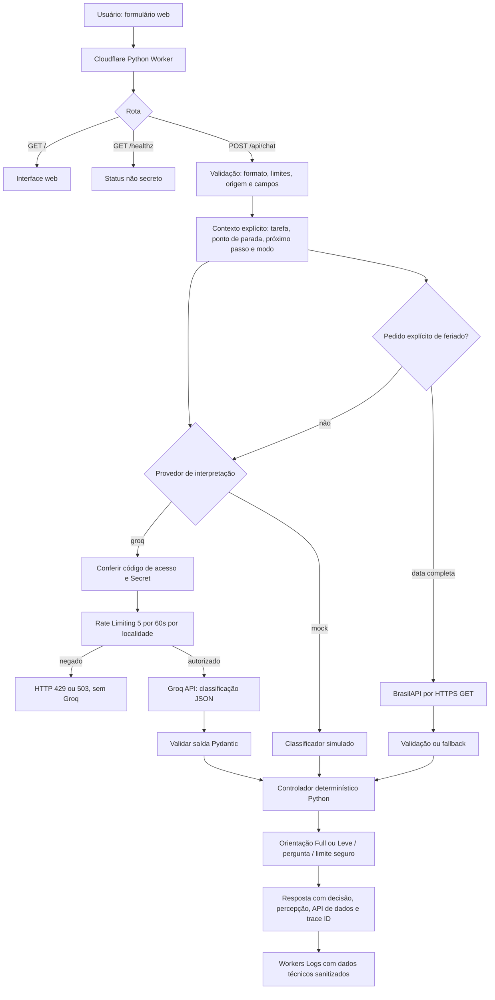

# Arquitetura técnica do FIO — Fase 3

**Estado documentado em 28/10/2026:** Worker Python v0.5.2 verificado em `https://fio.erika-srcastro.workers.dev/healthz`. O núcleo tem fluxo controlado por Python, com classificação de intenção opcional pelo Groq e consulta à BrasilAPI para feriados nacionais. Dados informados nos formulários são enviados em cada requisição; não existe memória durável entre solicitações.

## Fluxo de execução

**Nota de desenho:** o fluxo ilustra as alternativas; a consulta de feriado tem precedência sobre a classificação Groq. Entradas de vigilância/diagnóstico seguem guardrails determinísticos e não precisam da LLM para a resposta. O Python decide a ação final; a LLM classifica intenção e não executa ferramentas.

## Componentes e contratos

| Componente | Responsabilidade | Arquivos |
| --- | --- | --- |
| Interface | Recolher contexto explícito, selecionar Full/Leve e provedor; exibir decisão e trace | `web_ui.py` |
| Worker HTTP | Rotas, limites de corpo/campos, Secrets, conexão de rede, controle de origem e logging | `worker.py` |
| Percepção | Mock ou Groq `openai/gpt-oss-20b` classificando intenção com JSON estruturado | `fio/perception.py`, `fio/live_api.py` |
| Contratos | `Contexto`, `Percepcao`, `Modo`, `Resultado`, validação Pydantic | `fio/models.py` |
| Decisão | Regras Full/Leve, prioridade de guardrails, respostas sem invenção de histórico | `fio/agent.py` |
| Orquestração | Chamada externa controlada, autorização, rate limiting e tratamento de falhas | `fio/worker_runtime.py` |
| Dados externos | Consulta de feriados nacionais via BrasilAPI com data exata | `fio/feriados.py` |
| Infraestrutura | Cloudflare Python Workers, uv/Pywrangler, bindings gratuitos | `wrangler.toml`, `pyproject.toml` |

## Full versus Leve

- **Full:** reduz o esforço inicial com uma microação segura quando há tarefa e ponto de parada, mas não há próximo passo confirmado; quando há passo confirmado, o retoma diretamente.
- **Leve:** devolve uma escolha ou pergunta mais autônoma com o mesmo contexto.
- **Sem contexto mínimo:** solicita a informação necessária, com redações próprias de cada modo.
- **Nunca:** deduz o conteúdo de uma conversa passada, inventa uma tarefa, interpreta campos vazios como memória, diagnostica ou vigia.

## Segurança, privacidade e custos

- `GROQ_API_KEY` e `FIO_DEMO_ACCESS_KEY` são Cloudflare Secrets; nenhum valor consta do repositório.
- Groq fica atrás de código de demonstração e binding `FIO_GROQ_RATE` (5 solicitações/60s **por localidade da Cloudflare**, limite aproximado, não global).
- Ausência/falha do limitador bloqueia inferência Groq; o modo mock continua disponível.
- Cota Groq Free excedida resulta em 429 sem retry automático.
- Modo de demonstração não utiliza armazenamento durável, autenticação individual ou análise clínica.
- Workers Logs registra status, duração, decisão, tokens reportados e trace ID; não registra mensagens ou chaves pelo código da aplicação.
- Analytics Engine não está habilitado na v0.5.2: a exigência de ativação causou o incidente INC-002 / erro 10089; adotados apenas Workers Logs Free.
- Orçamento permitido: **R$ 0**; ambos os planos Free foram confirmados pela responsável.

## Evidências e limites

- **BrasilAPI real:** API-01, trace `2d46a92f-e7d0-4798-a017-59dade03fc1c`.
- **Groq real:** API-02 (v0.4.0) e REG-01 (v0.4.1), com respostas diferentes para Full e Leve no mesmo contexto.
- **Deploy v0.5.2:** `/healthz` observado com `llm: protected`, `groq_rate_limit: configured`, `metrics_backend: workers_logs`, `usage_analytics: not_enabled`.
- **CI:** 74 testes automatizados aprovados em [run 40724281556](https://github.com/erikasrcastro/FIO/actions/runs/40724281556).
- **Pendências:** provar 429 do limitador no Worker vivo, conferir evento nos Workers Logs, testar Groq após deploy 0.5.2, cargas leves, avaliação de consistência e cobertura mais ampla de ataques.

Links: [validação](VALIDACAO.md), [evidências de produção](EVIDENCIAS_CLOUDFLARE_2026-10-28.md), [segurança](SEGURANCA_CONSUMO.md), [incidente](INCIDENTE_BUILD_2026-10-28.md).
